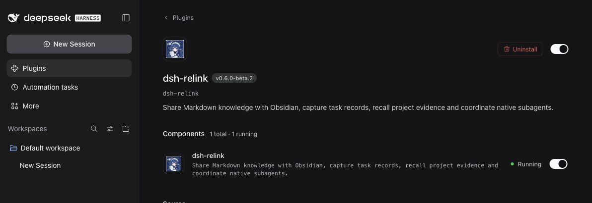
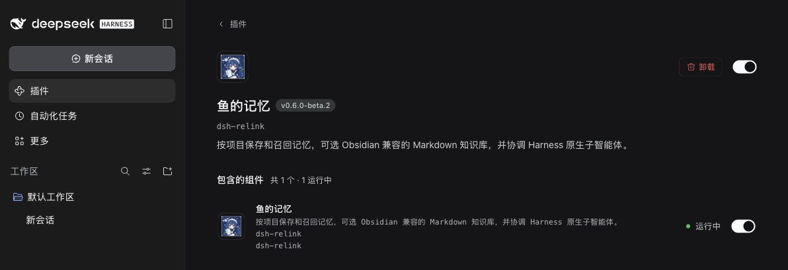

<p align="center">
  
</p>

<h1 align="center">dsh-relink · 鱼的记忆</h1>

<p align="center">
  <b>Project memory and native subagent coordination for <a href="https://github.com/deepseek-ai/deepseek-harness">DeepSeek Harness</a></b><br />
  <b>面向 DeepSeek Harness 的项目记忆与原生子代理协作插件</b>
</p>

<p align="center">
  
  
  
  
  
</p>

<p align="center"><a href="#english">English</a> · <a href="#简体中文">简体中文</a></p>

---

## English

**dsh-relink** (formerly dsh-memory-team) helps a Harness agent stop rediscovering what it already knows. Before each new request reaches the model, it recalls the few verified findings that matter for the current project, and when nothing relevant exists it says so instead of adding noise. It can split genuinely independent investigations between two native subagents and show where a slow turn spent its time. It never imposes model deadlines, cancels valid work or truncates requested output.

> [!NOTE]
> This is an unofficial community project and a **prerelease**. Please try it in a separate test profile first. See [Status](#status).

### Interface



### Highlights

- **Relevant recall, not noise.** One deterministic relevance model for every backend. Naming a record's key or full title finds it; generic requests such as "please check this file" recall nothing.
- **Local by default.** Memory lives in a local SQLite database with no account, service or extra model call. An optional Markdown vault works with Obsidian and any editor.
- **Nothing runs in the background.** No file watchers, timers or helper processes. Services start on first use, and external edits are picked up on the next read.
- **Honest health reporting.** Every result is `ok`, `no-match`, `degraded`, `withheld` or `unavailable`, so a broken component never looks like an empty memory.
- **Native coordination.** `team_start` uses the host's own `subagent` tool, so permissions, cancellation, recursion limits and result delivery stay under Harness control.
- **Safe upgrades.** 0.5.x databases and notes are read in place, and a round trip with 0.5.3-beta.3 on the same data is tested.

### Measured in 0.6

Same workloads against 0.5.3-beta.3, five fresh-process runs each, medians. Measured on an Apple M1 with a synthetic labelled corpus; details and trade-offs are in [docs/benchmarks.md](docs/benchmarks.md).

| | 0.5.3-beta.3 | 0.6.0-beta.1 |
| --- | --- | --- |
| Unrelated requests that still received recalled records | 40-80% | 0-4% |
| Precision of recalled records | 43-71% | 94-97% |
| First Markdown search over 2,000 existing notes | 861 ms | 312 ms |
| External note edit visible to the next search | 224-330 ms | 107-126 ms |
| Time added to a desktop-runtime cold start | about 100-125 ms | about 50 ms |
| Background helper process with a vault configured | about 190 MiB (Basic Memory) | none |

Some searches are 1-2 ms slower than before; [the benchmark notes](docs/benchmarks.md#reading-the-results) explain why.

### Features

| | What it does |
| --- | --- |
| **Project memory** | Adds up to three relevant records for the current project before each new user input reaches the model. Records are isolated by project (Git root or working directory). Expired records and records whose evidence files changed are not recalled automatically. |
| **Markdown vault** (optional) | Stores records as plain Markdown that you can edit in Obsidian. The plugin never rewrites your notes on its own, and replacements made through the save tool keep the previous version in history. Add `dsh_private: true` to keep a note out of recall. |
| **Task records** (with a vault) | Records each finished turn as an *unverified* journal note (request, final reply, outcome and tool names) without any model call. Reasoning, tool arguments and tool outputs are not stored. |
| **Subagent coordination** | `team_start` runs up to two independent investigations in parallel; the parent keeps ownership of edits and final acceptance. `team_wait` waits once, without polling. |
| **Execution diagnostics** | `workflow_status` reports steps, output, retries and a breakdown of wall time. At most three short reminders per turn flag repeated identical results or very long turns; they never block tools or end tasks. |

### Requirements

- DeepSeek Harness **0.2.1-rc.2 or 0.2.1-rc.3**
- Node.js **22.17 or later** (the Harness desktop app already ships a suitable runtime)
- Optional: Obsidian, [Basic Memory](https://github.com/basicmachines-co/basic-memory) 0.23.2 or Betterleaks 1.9.0, all installed separately

### Installation

1. Download `dsh-relink-0.6.0-beta.2.tgz` from [Releases](https://github.com/ytsu-ki/dsh-relink/releases) and check it against `SHA256SUMS`.
2. In Harness, open **Plugins > Add plugin** (preferably in a test profile) and enter the absolute path of the downloaded file.
3. Enable **dsh-relink** and restart Harness when prompted.

From the command line:

```sh
dsh plugin --profile my-test-profile add /absolute/path/dsh-relink-0.6.0-beta.2.tgz
```

That is all you need: memory works immediately with local SQLite. Do not edit profile manifests or lockfiles by hand.

<details>
<summary><b>Optional: Markdown vault for Obsidian</b></summary>

```sh
node scripts/setup-knowledge.mjs \
  --vault '/absolute/path/to/Obsidian Vault/DSH Knowledge' \
  --project '/absolute/path/to/project' \
  --config-dir '/absolute/path/to/plugin-state'
```

The script creates the vault and saves the settings to `~/.local/share/dsh-memory-team/settings.json` (this folder keeps the plugin's former name so existing settings still apply), keeping a backup of any previous file. Reload the plugin afterwards. Options: `--seed-file /absolute/notes.json` imports approved `[key, title, kind, summary, evidence]` rows without overwriting existing keys; `--no-activate` prepares files without changing settings.

Keep the `dsh_` frontmatter fields when editing notes in Obsidian. No Obsidian plugin is required.
</details>

<details>
<summary><b>Optional: Basic Memory</b></summary>

The plugin does not start or require Basic Memory. If you want Basic Memory's own tools on the same vault, install official Basic Memory 0.23.2 separately (on macOS arm64, [`scripts/basic-memory-macos-arm64.txt`](scripts/basic-memory-macos-arm64.txt) pins a verified set of its dependencies for `pip install -r`) and pass `--basic-memory-config /absolute/path` to the setup script. With the settings the script writes, Basic Memory 0.23.2 indexes the plugin's notes without modifying them. Basic Memory 0.24 writes a `permalink` field into notes; the plugin tolerates this, but each rewritten note gets a new revision.
</details>

<details>
<summary><b>Optional: credential scanning with Betterleaks</b></summary>

```sh
node scripts/setup-retrieval.mjs
```

Downloads the pinned Betterleaks 1.9.0 release (macOS and Linux, arm64 or x64), verifies its SHA-256 and enables it. `--archive /absolute/release.tar.gz` installs offline. Without Betterleaks, built-in rules still redact common credential formats.
</details>

### Usage

Give Harness a task as usual; the model decides when to search, save or delegate. You can also ask directly:

> Search this project's memory first. Give the implementation investigation and the test review to two independent subagents, fix the problem yourself, then save the verified conclusion.

| Tool | Purpose |
| --- | --- |
| `project_memory_search` | Search the current project; an empty query lists recent records |
| `project_memory_save` | Save a verified fact, workflow or pitfall with evidence |
| `project_memory_forget` | Remove a record by key and current revision |
| `project_memory_status` | Show backend, storage paths, health and configuration problems |
| `team_start` | Launch up to two independent investigations |
| `team_wait` | Wait once for native child work, then list task states |
| `workflow_status` | Show steps, output, retries and time breakdown for a turn |

```json
{
  "key": "viewport-acceptance",
  "title": "Prerequisites for 1440px acceptance",
  "kind": "pitfall",
  "summary": "Close overlays before checking button clickability at 1440px.",
  "evidence": "Playwright trace showed the cookie banner intercepting clicks.",
  "files": ["tests/layout.test.js"]
}
```

Evidence files are fingerprinted, not copied; if one changes, the record stops being recalled automatically. Replacing a record requires its current `expected_revision`, which a search returns.

### Configuration

All settings are optional and can be changed in the plugin settings.

| Setting | Default | Meaning |
| --- | --- | --- |
| `database` | `$DSH_PROFILE_DIR/data/dsh-memory-team.sqlite` | SQLite database (absolute path) |
| `knowledgeRoot` | unset | Absolute path of an existing Markdown vault |
| `knowledgeProject` | all projects | Only this project uses the vault; others use SQLite |
| `projectRoot` | automatic | Absolute root that groups itself and its subdirectories |
| `basicMemoryConfig` | `$DSH_PROFILE_DIR/data/basic-memory` | State directory for history, trash and the derived index (historical name) |
| `incrementalIndex` | `true` | `false` keeps the derived index in memory only |
| `betterleaksCommand` | unset | Absolute path to Betterleaks 1.9.0 |
| `ttlDays` | `30` | Records older than this (1-365 days) are not recalled automatically |
| `recallLimit` / `recallChars` | `3` / `6000` | Records and characters per automatic recall |
| `maxWorkers` | `2` | Parallel plugin-owned subagents (1-2) |
| `repeatThreshold` / `checkpointSteps` / `longOutputTokens` | `3` / `20` / `4000` | When execution reminders appear |

`basicMemoryCommand` is still accepted for compatibility and ignored. Storage paths such as the default database file keep the former name `dsh-memory-team` so existing data is found after the rename.

### Privacy

Everything is stored locally as plaintext. Recalled excerpts are sent to your model provider together with normal requests, so do not save credentials or private conversations. Credentials are screened before anything is saved, recorded or recalled, and a configured scanner that fails blocks memory transfer rather than letting it through. On Windows, files inherit their directory's permissions; see [docs/windows-acceptance.md](docs/windows-acceptance.md).

### Status

- **Verified:** macOS arm64 with the DeepSeek Harness 0.2.1-rc.3 desktop runtime (installation, tools, saving and recall across process restarts), and the test suite on Node.js 22.17, 24 and 26. See [docs/compatibility.md](docs/compatibility.md) for details.
- **Not yet verified:** Windows and Linux, and cold starts of the desktop window itself.
- Some 0.5.x users reported that the host failed to start or exited after enabling the plugin. The original cause has not been identified. 0.6 removes the most likely failure points: activation does no filesystem, process or network work, no background process or file watcher runs, and every background error is handled inside the plugin.

If Harness fails to start, choose **Disable third-party plugins, back up profile patch, and restart** in the recovery dialog (this affects other third-party plugins too). Please report problems with the [bug report template](https://github.com/ytsu-ki/dsh-relink/issues/new?template=bug_report.yml), including the `crash-...-host.log` from the dialog and the output of `project_memory_status`, with credentials and private data removed.

### Upgrading from 0.5.x (dsh-memory-team)

0.6 is published under the new name **dsh-relink**. Remove `dsh-memory-team` from the profile first, then install `dsh-relink`. If both stay enabled, whichever loads second fails to activate, so you could keep running the old version without noticing. Your settings, database and Markdown notes are picked up unchanged; no data conversion is needed. If your profile patch overrides the plugin configuration with `id: dsh-memory-team`, change it to `id: dsh-relink`.

Rolling back means removing `dsh-relink` and reinstalling `dsh-memory-team` 0.5.3-beta.3. The plugin no longer starts Basic Memory, so run it yourself if you use its tools. See [docs/migration.md](docs/migration.md) for the full procedure and the `scripts/migrate.mjs` inspection helper.

### Documentation

| Document | Contents |
| --- | --- |
| [Architecture](docs/architecture.md) | Design decision, data ownership, reconciliation and failure states |
| [Migration](docs/migration.md) | Upgrade, rollback and contract changes from 0.5.x |
| [Compatibility](docs/compatibility.md) | Supported versions and what was verified where |
| [Benchmarks](docs/benchmarks.md) | Methodology, results and trade-offs |
| [Windows acceptance](docs/windows-acceptance.md) | Manual checks still needed on Windows |
| [Slow-session notes](docs/slow-session-remedies.md) | Why the execution reminders and timing categories exist |

### Development

```sh
pnpm install --frozen-lockfile --ignore-scripts
pnpm check
pnpm test
pnpm bench
```

Tests run with the official Harness components and simulated models; no paid API is called. Setting `BASIC_MEMORY_TEST_COMMAND`, `BETTERLEAKS_TEST_COMMAND` or `DSH_RELINK_BASELINE_ENTRY` adds the real-service and rollback checks. `pnpm release:prepare` builds and cross-checks the install package and source archive.

The older stream-request guard is still available as `dsh-relink/legacy-stream-guard` but is deprecated and will be removed in 0.7.0 ([details](docs/legacy-stream-guard.md)).

### License

[MIT](LICENSE). Optional tools are installed separately under their own licenses: Betterleaks (MIT) and Basic Memory (AGPL-3.0-or-later). Obsidian is an optional editor, not a dependency.

---

## 简体中文

**鱼的记忆（dsh-relink）**（原名 dsh-memory-team）让 Harness 中的智能体不必反复探索已经知道的事情。每次新请求发送给模型之前，它会为当前项目召回少量真正相关的已验证结论；没有相关内容时，它会如实说明，而不是塞入无关信息。它还可以把真正独立的调查交给两个原生子代理并行处理，并展示一轮缓慢的任务把时间花在了哪里。它从不对模型设置时限、不取消有效工作，也不截断用户要求的输出。

> [!NOTE]
> 这是一个非官方的社区项目，目前为**预发布版**。请先在单独的测试配置（profile）中试用，详见[项目状态](#项目状态)。

### 界面



### 亮点

- **召回精准，不制造噪声**：所有存储后端共用同一套确定性的相关度模型。在请求中写出记录的键名或完整标题即可找到它；"请帮我检查这个文件"之类的泛化请求不会召回任何记录。
- **默认完全本地**：记忆保存在本地 SQLite 数据库中，不需要账号、服务或额外的模型调用。可选的 Markdown 知识库可以直接用 Obsidian 或任意编辑器编辑。
- **后台零常驻**：没有文件监听、定时器或辅助进程。服务在首次使用时才启动，外部编辑会在下一次读取时生效。
- **健康状态透明**：每个结果都标明 `ok`、`no-match`、`degraded`、`withheld` 或 `unavailable`，组件故障不会被误认为"没有记忆"。
- **原生协作**：`team_start` 调用宿主自带的 `subagent` 工具，权限、取消、递归层数限制和结果投递都由 Harness 管理。
- **升级安全**：0.5.x 的数据库和笔记原地读取，并且测试过与 0.5.3-beta.3 在同一份数据上来回切换。

### 0.6 实测数据

在相同负载下与 0.5.3-beta.3 对比，每项在全新进程中重复 5 次，取中位数。测试环境为 Apple M1 和一套带标注的合成语料，方法与取舍详见 [docs/benchmarks.md](docs/benchmarks.md)。

| | 0.5.3-beta.3 | 0.6.0-beta.1 |
| --- | --- | --- |
| 无关请求仍被注入记录的比例 | 40-80% | 0-4% |
| 召回记录的精确率 | 43-71% | 94-97% |
| 首次检索 2,000 条已有 Markdown 笔记 | 861 ms | 312 ms |
| 外部编辑后，下一次检索可见所需时间 | 224-330 ms | 107-126 ms |
| 桌面运行时冷启动增加的耗时 | 约 100-125 ms | 约 50 ms |
| 配置知识库后的后台辅助进程 | 约 190 MiB（Basic Memory） | 无 |

部分检索比以前慢 1-2 ms，原因见[基准测试说明](docs/benchmarks.md#reading-the-results)。

### 功能

| | 作用 |
| --- | --- |
| **项目记忆** | 每次新的用户输入发送给模型前，为当前项目补充最多三条相关记录。记录按项目隔离（Git 根目录或工作目录）。过期记录、以及证据文件已变化的记录不会被自动召回。 |
| **Markdown 知识库**（可选） | 以纯 Markdown 保存记录，可在 Obsidian 中编辑。插件不会擅自改写你的笔记；通过保存工具替换记录时，旧版本会保留在历史记录中。在笔记中加入 `dsh_private: true` 即可让它不参与召回。 |
| **任务记录**（需配置知识库） | 每轮任务结束后自动记一条*未经验证*的日志笔记（请求、最终回复、结果和工具名称），不调用模型；不保存推理过程、工具参数和工具输出。 |
| **子代理协作** | `team_start` 最多并行运行两个独立调查；修改与最终验收仍由主代理负责。`team_wait` 只等待一次，不轮询。 |
| **执行诊断** | `workflow_status` 报告步数、输出量、重试次数和耗时分解。每轮最多三条简短提醒，提示重复的相同结果或过长的任务；提醒从不阻止工具调用，也不会结束任务。 |

### 环境要求

- DeepSeek Harness **0.2.1-rc.2 或 0.2.1-rc.3**
- Node.js **22.17 或更高版本**（Harness 桌面版已自带合适的运行时）
- 可选：Obsidian、[Basic Memory](https://github.com/basicmachines-co/basic-memory) 0.23.2 或 Betterleaks 1.9.0，均需另行安装

### 安装

1. 从 [Releases](https://github.com/ytsu-ki/dsh-relink/releases) 下载 `dsh-relink-0.6.0-beta.2.tgz`，并用 `SHA256SUMS` 核对校验和。
2. 在 Harness 中打开 **Plugins > Add plugin**（建议使用测试配置），输入下载文件的绝对路径。
3. 启用 **鱼的记忆**，按提示重启 Harness。

命令行安装：

```sh
dsh plugin --profile my-test-profile add /absolute/path/dsh-relink-0.6.0-beta.2.tgz
```

到这里就可以使用了：记忆功能默认使用本地 SQLite，开箱即用。请不要手动编辑配置清单或锁文件。

<details>
<summary><b>可选：配合 Obsidian 使用 Markdown 知识库</b></summary>

```sh
node scripts/setup-knowledge.mjs \
  --vault '/absolute/path/to/Obsidian Vault/DSH Knowledge' \
  --project '/absolute/path/to/project' \
  --config-dir '/absolute/path/to/plugin-state'
```

该脚本会创建知识库目录，并把设置写入 `~/.local/share/dsh-memory-team/settings.json`（该目录沿用插件的旧名称，以便继续使用已有设置；原有文件会先备份），完成后请重新加载插件。`--seed-file /absolute/notes.json` 可导入已审核的 `[key, title, kind, summary, evidence]` 记录，且不会覆盖已有的键；`--no-activate` 只准备文件，不修改设置。

在 Obsidian 中编辑笔记时请保留以 `dsh_` 开头的 frontmatter 字段。不需要安装任何 Obsidian 插件。
</details>

<details>
<summary><b>可选：Basic Memory</b></summary>

插件不会启动、也不依赖 Basic Memory。如果你想在同一个知识库上使用 Basic Memory 自带的工具，请另行安装官方 Basic Memory 0.23.2（在 macOS arm64 上，可用 [`scripts/basic-memory-macos-arm64.txt`](scripts/basic-memory-macos-arm64.txt) 中经过验证的依赖版本执行 `pip install -r`），并在运行设置脚本时加上 `--basic-memory-config /absolute/path`。按脚本写入的设置，Basic Memory 0.23.2 能索引插件的笔记而不修改它们。Basic Memory 0.24 会往笔记里写入 `permalink` 字段：插件可以兼容，但每条被改写的笔记都会得到新的修订号（revision）。
</details>

<details>
<summary><b>可选：使用 Betterleaks 扫描凭据</b></summary>

```sh
node scripts/setup-retrieval.mjs
```

该脚本会下载固定版本的 Betterleaks 1.9.0（支持 macOS 和 Linux 的 arm64 / x64），校验 SHA-256 后启用。`--archive /absolute/release.tar.gz` 可离线安装。即使不安装 Betterleaks，内置规则也会屏蔽常见格式的凭据。
</details>

### 使用

像平常一样给 Harness 布置任务即可，由模型自行决定何时检索、保存或分派任务。你也可以直接要求：

> 先检索本项目的记忆。把实现排查和测试审查分别交给两个独立的子代理，由你亲自修复问题，验证通过后保存结论。

| 工具 | 用途 |
| --- | --- |
| `project_memory_search` | 检索当前项目；查询为空时列出最近的记录 |
| `project_memory_save` | 保存带证据的已验证事实、工作流程或踩坑经验 |
| `project_memory_forget` | 按键名和当前修订号删除一条记录 |
| `project_memory_status` | 查看存储后端、存储路径、健康状态和配置问题 |
| `team_start` | 启动最多两个独立调查 |
| `team_wait` | 等待一次原生子任务完成，并列出各任务状态 |
| `workflow_status` | 查看一轮任务的步数、输出量、重试次数和耗时分解 |

```json
{
  "key": "viewport-acceptance",
  "title": "Prerequisites for 1440px acceptance",
  "kind": "pitfall",
  "summary": "Close overlays before checking button clickability at 1440px.",
  "evidence": "Playwright trace showed the cookie banner intercepting clicks.",
  "files": ["tests/layout.test.js"]
}
```

证据文件只记录指纹，不复制内容；文件一旦变化，该记录就不再被自动召回。替换已有记录时需要提供当前的 `expected_revision`，可以从检索结果中获得。

### 配置

所有设置均为可选，可在插件设置中修改。

| 设置 | 默认值 | 说明 |
| --- | --- | --- |
| `database` | `$DSH_PROFILE_DIR/data/dsh-memory-team.sqlite` | SQLite 数据库（绝对路径） |
| `knowledgeRoot` | 未设置 | 已存在的 Markdown 知识库的绝对路径 |
| `knowledgeProject` | 所有项目 | 仅此项目使用知识库，其他项目使用 SQLite |
| `projectRoot` | 自动 | 绝对路径；该目录及其子目录视为同一个项目 |
| `basicMemoryConfig` | `$DSH_PROFILE_DIR/data/basic-memory` | 存放历史版本、回收站和派生索引的状态目录（沿用旧名称） |
| `incrementalIndex` | `true` | 设为 `false` 时派生索引只保存在内存中 |
| `betterleaksCommand` | 未设置 | Betterleaks 1.9.0 的绝对路径 |
| `ttlDays` | `30` | 超过该天数（1-365）的记录不再被自动召回 |
| `recallLimit` / `recallChars` | `3` / `6000` | 每次自动召回的记录数和字符数上限 |
| `maxWorkers` | `2` | 插件可并行使用的子代理数量（1-2） |
| `repeatThreshold` / `checkpointSteps` / `longOutputTokens` | `3` / `20` / `4000` | 执行提醒的触发条件 |

为保持兼容，`basicMemoryCommand` 仍可配置，但会被忽略。默认数据库文件等存储路径沿用旧名称 `dsh-memory-team`，因此改名后仍能找到已有数据。

### 隐私

所有数据都以明文保存在本地。召回的摘录会随正常请求发送给你使用的模型服务商，因此请不要保存凭据或私密对话。保存、记录和召回之前都会筛查凭据；如果已配置的扫描器出现故障，插件会阻止记忆传输，而不是直接放行。在 Windows 上，文件沿用所在目录的权限，详见 [docs/windows-acceptance.md](docs/windows-acceptance.md)。

### 项目状态

- **已验证**：macOS arm64 上的 DeepSeek Harness 0.2.1-rc.3 桌面运行时（安装、工具调用、保存以及跨进程重启后的召回），以及 Node.js 22.17、24 和 26 上的测试套件。详情见 [docs/compatibility.md](docs/compatibility.md)。
- **尚未验证**：Windows 和 Linux，以及桌面窗口本身的冷启动。
- 部分 0.5.x 用户反馈启用插件后宿主无法启动或意外退出，原始原因至今尚未查明。0.6 消除了最可能的故障点：激活时不进行任何文件、进程或网络操作，不运行后台进程或文件监听，所有后台错误都在插件内部处理。

如果 Harness 无法启动，请在恢复对话框中选择 **Disable third-party plugins, back up profile patch, and restart**（这也会影响其他第三方插件）。反馈问题请使用 [Bug 报告模板](https://github.com/ytsu-ki/dsh-relink/issues/new?template=bug_report.yml)，附上对话框给出的 `crash-...-host.log` 和 `project_memory_status` 的输出，并删除其中的凭据和隐私信息。

### 从 0.5.x（dsh-memory-team）升级

0.6 起以新名称 **dsh-relink** 发布。请先从配置中移除 `dsh-memory-team`，再安装 `dsh-relink`。如果两者同时启用，后加载的那个会激活失败，你可能在不知情的情况下继续运行旧版本。已有的设置、数据库和 Markdown 笔记会被原样沿用，无需转换数据。如果你的配置补丁（profile patch）用 `id: dsh-memory-team` 覆盖了插件配置，请改为 `id: dsh-relink`。

回退时，移除 `dsh-relink` 并重新安装 `dsh-memory-team` 0.5.3-beta.3 即可。新版插件不再启动 Basic Memory，如果你需要使用它的工具，请自行运行。完整步骤和检查工具 `scripts/migrate.mjs` 见 [docs/migration.md](docs/migration.md)。

### 文档

以下文档为英文：

| 文档 | 内容 |
| --- | --- |
| [Architecture](docs/architecture.md) | 设计决策、数据归属、同步方式与故障状态 |
| [Migration](docs/migration.md) | 从 0.5.x 升级、回退及接口变化 |
| [Compatibility](docs/compatibility.md) | 支持的版本以及各环境的验证情况 |
| [Benchmarks](docs/benchmarks.md) | 测试方法、结果与取舍 |
| [Windows acceptance](docs/windows-acceptance.md) | Windows 上仍需人工完成的验收项 |
| [Slow-session notes](docs/slow-session-remedies.md) | 执行提醒和耗时分类的设计背景 |

### 开发

```sh
pnpm install --frozen-lockfile --ignore-scripts
pnpm check
pnpm test
pnpm bench
```

测试使用 Harness 官方组件和模拟模型，不会调用任何付费 API。设置 `BASIC_MEMORY_TEST_COMMAND`、`BETTERLEAKS_TEST_COMMAND` 或 `DSH_RELINK_BASELINE_ENTRY` 可额外运行真实服务和回退测试。`pnpm release:prepare` 会构建并交叉校验安装包和源码包。

旧版流式请求守卫仍可通过 `dsh-relink/legacy-stream-guard` 使用，但已弃用，将在 0.7.0 中移除（[详情](docs/legacy-stream-guard.md)）。

### 许可证

[MIT](LICENSE)。可选工具需另行安装，并遵循各自的许可证：Betterleaks（MIT）、Basic Memory（AGPL-3.0-or-later）。Obsidian 只是可选的编辑器，不是本项目的依赖。
